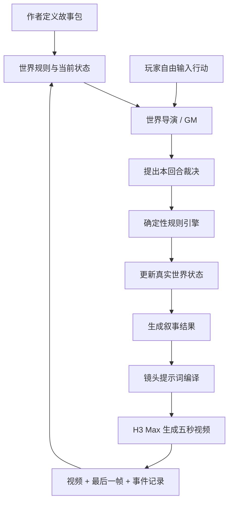

# 实时生成式互动内容：总体规则

## 1. 产品概述

本项目是一种由玩家自由输入行动、由 AI 世界导演裁决结果，并通过 MiniMax H3 Max 实时生成后续视频的互动内容形态。

它更接近一场由 AI 主持的桌面角色扮演游戏：作者负责提供世界规则和故事骨架，世界导演负责理解玩家意图，规则引擎负责执行确定性裁决，H3 Max 则负责把已经发生的结果拍摄成连续的五秒视频。

产品的核心体验是：

> 玩家可以提出预制分支之外的行动，世界会在既有规则范围内理解、回应并记住这个行动，随后把结果转化为可见的动态画面。

系统不追求传统游戏的实时帧渲染，而采用“观看五秒场景 → 自由行动 → 世界裁决 → 生成下一段场景”的回合式互动节奏。

## 2. 核心设计原则

### 2.1 作者定义边界，导演填充过程

作者只需要定义世界设定、角色、数值、不可变真相、故事节拍和结局条件，不需要穷举所有玩家可能采取的行动。

世界导演可以自由解释玩家行为、设计合理后果和组织角色反应，但不能修改作者定义的底层规则。

### 2.2 真实状态与生成画面分离

结构化的世界状态是唯一可信来源。视频只是当前状态和事件的视觉表达，不参与决定游戏事实。

如果生成视频出现服装、颜色或道具位置等视觉偏差，系统不得反向修改世界状态来迎合生成结果。

### 2.3 导演提出裁决，规则引擎执行裁决

世界导演不能直接重写完整状态，只能提交有理由、有依据的状态变更建议。确定性规则引擎负责校验条件、限制数值变化幅度，并生成最终状态。

### 2.4 玩家行动必须产生反馈

合理行动需要产生可感知的结果。即使行动失败，也应当带来新信息、关系变化、资源损失、风险上升或其他叙事后果，避免出现没有意义的空回合。

### 2.5 保留玩家的决定权

系统可以描述玩家已经声明的动作及其自然结果，但不能替玩家做出承诺、背叛、牺牲、告白或其他重大选择。

## 3. 系统总体流程



每个回合依次完成以下步骤：

1. 玩家用自然语言输入行动。
2. 世界导演识别行动目标、意图、手段和风险。
3. 世界导演依据当前状态提出结果与状态变化建议。
4. 规则引擎校验建议，并更新唯一真实状态。
5. 世界导演根据最终状态生成本回合叙事结果。
6. 镜头编译器把叙事结果转化为 H3 Max 可执行的镜头提示词。
7. H3 Max 生成五秒视频。
8. 系统保存视频、最后一帧和事件记录，进入下一回合。

## 4. 作者需要定义的故事包

每个互动故事由以下六类内容组成。

### 4.1 世界设定

- 玩家身份与初始处境
- 故事发生的时间和空间
- 玩家当前的主要目标
- 世界特有的自然、社会或超自然规则
- 阻止玩家立即完成目标的核心冲突

### 4.2 角色

每个主要角色至少需要定义：

- 身份与外在特征
- 当前目标
- 核心欲望与恐惧
- 已知信息与未知信息
- 行为边界
- 对不同类型行动的基本倾向

角色不是单纯等待玩家提升数值的奖励对象。相同行动面对不同角色、不同上下文时，可以产生不同结果。

### 4.3 数值定义

每个故事只应选择真正影响玩法的少量数值，建议总数控制在三至六个。

角色关系数值可以包括：

- **信任**：角色是否相信玩家不会欺骗或伤害自己。
- **亲密**：角色是否愿意暴露脆弱、建立情感连接。
- **怀疑**：角色认为玩家有所隐瞒或具有危险性的程度。
- **恐惧**：角色当前受到环境或玩家压迫的程度。

世界状态数值可以包括：

- **威胁值**：世界对玩家施加危险的程度。
- **崩坏值**：环境发生异常变化的程度。
- **剩余时间**：距离不可逆事件还有多少回合。

数值默认限定在 `0–100`。作者必须为每个数值说明其含义，避免导演仅凭名称自由解释。

### 4.4 故事节拍

故事节拍是可能发生的关键事件，而不是固定顺序的预制分支。每个节拍需要定义解锁条件；条件满足后，节拍进入“可发生”状态，由世界导演判断当前场景是否适合触发。

世界导演不得为了追赶大纲而忽略玩家正在进行的探索，也不得在条件尚未满足时强行触发关键事件。

### 4.5 成功与失败条件

结局必须由规则引擎能够判断的硬条件组成。推荐同时使用数值阈值和状态标签，而不是只依赖单一数值。

示例：

```text
共同逃脱成功：
- 亲密 >= 70
- 信任 >= 60
- 已知晓循环真相 = true
- 没有背叛角色 = true
- 关键道具仍然可用 = true
```

导演负责演绎成功或失败的具体表现，但不能绕过条件宣布结局。

### 4.6 不可变真相

不可变真相是世界的底层答案，例如幕后身份、事件原因、特殊规则和关键道具的真实用途。

玩家可以尚未发现真相，角色也可以误解真相，但世界导演不能在游戏进行中临时改变真相以制造反转。

## 5. 世界状态

世界状态至少包含以下内容：

- 当前回合、时间与位置
- 角色数值
- 世界数值
- 玩家和角色持有的资源或道具
- 已成立的状态标签
- 已发现的线索
- 已解锁或已完成的故事节拍
- 最近发生的事件
- 用于保持画面连续性的视觉锚点

数值用于表达程度，状态标签用于表达某件事是否真实发生过。

例如：

```text
林夏.信任 = 64
林夏.亲密 = 52
世界.威胁 = 38
玩家已承诺共同逃跑 = true
玩家曾向林夏隐瞒车票 = true
红色车票已使用 = false
```

## 6. 世界导演的回合裁决

### 6.1 意图理解

导演需要识别：

- 玩家实际采取了什么行动
- 行动针对谁或什么对象
- 玩家希望达到什么目的
- 使用了什么手段或资源
- 行动可能带来什么风险

### 6.2 可行性与结果等级

每次行动必须被归入以下结果之一：

- **不可能**：违反已经确立的物理条件或世界规则。
- **失败**：行动可以尝试，但没有达到主要目的。
- **有代价的成功**：主要目的实现，同时产生损失或新风险。
- **成功**：行动产生合理的预期效果。
- **重大成功**：只用于具有充分铺垫的关键行动。

“不可能”不等于没有反馈。系统仍可通过环境反应、角色态度或新线索回应玩家的尝试。

### 6.3 数值变化

世界导演只能建议数值变化，并且必须为每项变化提供原因和状态依据。

建议幅度如下：

| 影响程度 | 建议变化 |
| --- | ---: |
| 无实质影响 | `0` |
| 轻微影响 | `±1～3` |
| 明确影响 | `±4～7` |
| 重大行动 | `±8～12` |
| 不可逆剧情事件 | `±13～20` |

普通赞美、重复对话或低成本行为不能产生重大收益。承担风险、暴露秘密、牺牲重要资源或完成关键承诺，才可能引发显著变化。

### 6.4 状态变更

导演必须以状态补丁的形式提交变更，而不是重新生成完整状态。状态补丁可以包含：

- 数值增加或减少
- 标签设为真或假
- 道具转移、获得、消耗或损坏
- 新增线索
- 新增角色记忆
- 解锁故事节拍

### 6.5 裁决原则

- 每项变化都必须能追溯到玩家行动和既有事实。
- 玩家意图良好不代表结果必然良好，手段和上下文同样重要。
- 重复使用相同行动时，收益应递减，必要时可以引起反感或怀疑。
- 角色依据自己的目标、价值观和记忆作出反应。
- 失败也需要推动关系、信息、资源或风险中的至少一项发生变化。
- 导演不能泄露角色当前不可能知道的信息。
- 已经发生的事件不能被无理由撤销或重写。

## 7. 确定性规则引擎

规则引擎不负责创作剧情，只负责维护世界的一致性。它需要：

- 检查导演提出的变化是否满足前置条件。
- 将数值限制在作者设定的合法区间。
- 限制单回合数值变化幅度。
- 拒绝违反不可变真相的状态修改。
- 检查道具和资源是否真实存在且可以使用。
- 计算故事节拍、成功条件和失败条件是否满足。
- 生成最终状态，并记录本回合实际执行的变化。

当导演建议与规则冲突时，以规则引擎的结果为准。

## 8. 叙事结果与镜头生成

只有在真实状态更新完成后，系统才能生成叙事结果和视频提示词。

叙事结果需要明确：

- 本回合实际发生的事情
- 角色可见的动作和反应
- 环境产生的变化
- 玩家能够感知的新信息
- 下一回合开始时的场景状态

镜头编译器只能表现已经由规则引擎确认的结果，不能为了画面戏剧性增加新的关键事件、道具、人物决定或状态变化。

H3 Max 生成的视频需要尽量继承上一段视频的最后一帧，并结合角色外观、场景布局、道具状态、镜头语言和声音要求维持连续性。

## 9. 每回合的标准输出

每次世界导演裁决应生成以下结构化内容：

1. 玩家意图
2. 行动目标与手段
3. 可行性判断
4. 结果等级
5. 建议数值变化及原因
6. 建议状态标签变化
7. 道具和资源变化
8. 新增角色记忆
9. 解锁的故事节拍
10. 规则引擎实际执行的变化
11. 玩家可见的叙事结果
12. 镜头导演所需的场景摘要

## 10. 玩家反馈与调试模式

默认体验不直接展示精确数值。玩家通过角色语言、表情、距离、行为以及环境变化感知关系和风险，例如“她开始相信你”或“她对你的动机产生了怀疑”。

作者调试模式需要展示：

- 回合前后的完整状态
- 每项数值变化及其原因
- 被规则引擎接受、限制或拒绝的建议
- 新解锁的故事节拍
- 当前满足和未满足的结局条件

这使作者能够判断导演的裁决是否稳定、可解释，并及时调整故事规则。

## 11. 系统边界

世界导演、规则引擎和镜头导演是三个职责不同的模块。初期可以由同一个语言模型分阶段完成，但必须使用独立的输入输出流程，不能在一次自由生成中同时决定状态、修改规则和编写视频提示词。

系统的优先级顺序始终是：

```text
不可变真相
    > 确定性规则
    > 当前真实状态
    > 世界导演裁决
    > 叙事表现
    > 生成视频
```

任何视觉表现都不能覆盖更高优先级的事实。这是保证长时间自由探索仍能维持因果一致性的基础。

## 12. 故事包

- [《无籍之城》故事总览](./UNREGISTERED_CITY.md)：以边境驿站经营、宿籍分配和无籍者生存为核心的快速版故事包。
